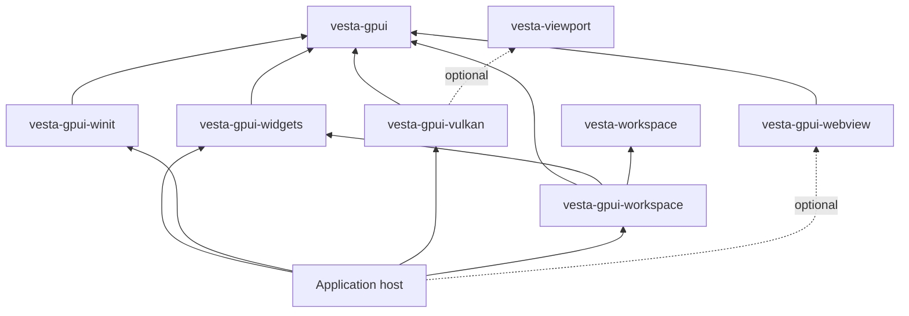

# Architecture and ownership

This is the current implementation map. The [refinement programme](REFINEMENT.md)
tracks remaining audits; this document does not assert that every API is already
minimal. Changes to a boundary require a decision and its checks.

## Libraries

| Package | Owns | Receives from its caller | Does not own |
| --- | --- | --- | --- |
| `vesta-gpui` | Element identity; derived layout, paint and hit data; text/editing contracts; input ownership; semantics and bounded trace data | Element trees, fonts/text contexts, input intent, explicit capture configuration | OS event loop, native window, GPU device, application document or account |
| `vesta-gpui-widgets` | Reusable projections and typed interaction state | Stable IDs, values, actions, theme, explicit interaction owners | Business meaning, author persistence, provider I/O or a second text engine |
| `vesta-gpui-winit` | Native event/IME/accessibility adaptation; explicitly started stdio and trace transport helpers; monitor geometry | Existing native windows, dispatch, clipboard and host permissions | Application state, approvals, event-loop policy or renderer |
| `vesta-gpui-vulkan` | Paint preparation, GPU submission, surfaces, bounded resource retention and retirement | Window/device inputs, paint, caller text/image resources and optional scenes | Pane/session state, author data, input routing or model services |
| `vesta-workspace` | Stable pane/tab/split model and its serialization | Typed workspace operations and stable IDs | UI elements, native windows or GPU resources |
| `vesta-gpui-workspace` | Workspace UI projection, resolved geometry and gesture helpers | The existing workspace model, IDs, input ownership and host actions | A second workspace model, native window management or persistence policy |
| `vesta-viewport` | Backend-neutral camera, scene and geometry snapshots | Explicit immutable preview data | OS/GPU lifetime or authoring runtime |
| `vesta-gpui-webview` | Optional native browser carrier, read-only asset mounts and per-view I/O/profile retirement | Native parent, fixed event tag, bounds/content policy, mounted resources and Host retirement group | Agent authority, approvals, durable app profile lifecycle, application documents or a replacement renderer |

Arrows mean production dependencies. Libraries never depend on examples or Vesta
products. The model and viewport leaves have no dependency on the UI family.
The architecture verifier checks resolved normal/build paths, including optional
and target-specific paths; native support is still Windows-preview scope.

## State and frame lifetime

1. The host owns durable application data and the native event loop. It accepts
   intent through its existing typed actions and rebuilds projections from that
   same data. A widget must not create a second author model.
2. `InputOwnership` owns transient focus/capture for explicit window/element IDs.
   The host adapts native events and reconciles it with the current live route.
   Independent windows retain their own remembered focus. `WindowTextSession`
   identifies the single caret/IME owner of a shared editor; transferring that
   session does not erase another window's remembered focus.
   Text editor state owns text/history/composition; a text context owns font and
   measurement resources. Moving one cannot silently replace the other.
3. Element trees describe the current projection. Layout, actions, hit geometry,
   accessibility and paint derive from that projection. Retained layout reuses
   solver storage; it does not become another UI model or layout algorithm.
4. The host completes necessary text/scroll/layout reconciliation before exposing
   a frame for input and rendering. The Agent consumer currently bounds its own
   settlement to eight passes. Standalone now bounds its Main/Float preparation
   the same way, with one trace/timing frame and at most one renderer attempt per
   draw. This is host policy, not a shared SDK scheduling API. A stable CPU
   PaintList supplies both hit and text-input geometry before renderer entry;
   acquire deferral does not mix those with an older text viewport. Presented
   queries, accessibility and IME publication still follow successful submission.
   The window owns an explicit validity bit for its input projection, false
   during preparation and true after coherent text/hit geometry is installed.
   Incomplete preparation blocks input and releases geometry-dependent capture;
   native lifecycle events remain available. The existing query dirty state
   separately rejects commands until a successful presented publication. These
   states express different facts, with one owner each. The product Agent instead
   shares its existing needs-layout / rebuild-required / prepared candidate state
   between native and embedded paths on one App. It installs hit, CPU layout and
   text geometry together; semantic publication cannot replace input geometry.
   These are host policies, not a new SDK state machine or scheduler. Current
   joint adoption and Builder budget/fault integration remain open in GF03.
5. The renderer retains only the resources needed by submitted work, then retires
   them through its existing owner. Submission, GPU completion and physical
   display are distinct facts. Recovery preserves caller-owned CPU state.
6. Trace capture is opt-in and bounded. Native adapter export can freeze data and
   hand file output to the host's worker. The stdio helper is explicitly started,
   process-lifetime stdin/stdout transport, started once by a native process host;
   embedded controllers reuse that connection. It provides no join/cancellation
   handle because window close cannot cancel a blocking stdin read. EOF/failure
   releases the worker. Host callbacks must enqueue/serialize without blocking.
   Read-only polls share one condition deadline; its expiry preserves transport,
   while a disconnected ordinary reply retires it. This boundary and its tests
   are defined in [decision 0014](decisions/0014-Stdio-Wait-Budget-And-Process-Lifetime.md).
7. The optional browser child captures its creation tag; the Host rejects stale
   events and disposes children before parents. The existing per-view I/O worker
   owns resources and SDK temporary-profile cleanup. The Host-created retirement
   group owns only completion/error observations, never native state or a new
   executor. Dispose on the event thread, then observe off the live loop before
   process exit. Installed profiles stay Host-owned. See [WebView](WEBVIEW.md)
   and [decision 0016](decisions/0016-Webview-Identity-And-Native-Sync-Ownership.md).

## Public API admission

The [workspace model](WORKSPACE.md) has one private field representation and one
invariant validator. Construction and versioned restore create validated live
owners; a session only holds an untrusted snapshot until restore. Native Hosts
use narrow placement/title operations instead of mutating topology through a
floating-window reference. ID capacity is checked before compound changes.

Core values own basic size/rectangle validity. One private layout bridge owns
finite Style-to-Taffy input conversion for stateless, retained and measurement
paths; completed logical geometry is checked before publication. Image and Dock
reuse the value predicate instead of maintaining independent finiteness rules.
This is numeric admission around the same solver, not another layout algorithm,
frame-validity flag or geometry model. Raw DTO construction and direct render
math keep explicit input preconditions. See
[decision 0020](decisions/0020-Core-Geometry-Admission-And-Failure-Identity.md).

The [Dock projection](DOCK.md) borrows that model. One private numeric module
admits frame, resize and routing geometry. A complete fallible frame preserves
all tab ordering and layout direction; it is derived data, not a second model
revision. The Host publishes coherent model/regions/layout, owns native window
mapping and admission, and retires stale geometry-dependent interactions.

The [family boundary](SUPPORTED-API.md) owns the package support matrix and common
migration policy. Core, Widgets and renderer inventories own their detailed
contracts; the renderer does not define another package's support policy.

The [CPU preparation contract](RENDER-PREPARATION.md) maps Host-owned Style values
to derived paint and transient vertices. One private stroke body serves all
current callers. Owner registry updates stage generations before publishing;
capacity failure preserves the previous references without a second registry
or compensation state. Neither boundary owns application dispatch or GPU lifetime.

Every public addition must identify its caller, owner, necessary use case,
inputs/outputs, lifetime, errors and qualification. Keep pure operations separate
from I/O and platform adapters. A `pub` declaration alone is not an API design.
Private helpers stay private; example IDs/data and acceptance orchestration stay
in the examples. Optional renderer/preview/browser capabilities remain explicit.

## Standalone composition

The package's [native host recipe](HOSTING.md) is a small external-style consumer
of the same public APIs. Its private window/editor state does not enter a library
or replace the official applications. Its fixed single-field CPU projection and
finite smoke are explicit example policies, not shared scheduling abstractions.

The acceptance example has one `App` owner. Its root declares that owner, stable
IDs and composition; sibling modules borrow the same state rather than running
independent controllers. These are private binary modules, not SDK exports.

| Responsibility | Source owner |
| --- | --- |
| Demonstration values, pane history and defaults | `application_state` |
| Typed demonstration action dispatch | `demo_actions` |
| Main-window pointer and value gestures | `window_pointer` |
| Focus/text sessions, keyboard and menus | Existing `window_focus`, `window_keyboard`, `window_menus` |
| Native clipboard, resize edge and native observations | `window_platform` |
| Stateless root/overlay/control construction | `presentation`; gallery content stays in `gallery` |
| Workspace session storage and initial model | `workspace_session` |
| Fixed 3D demonstration scene | `viewport_demo`; library test fixtures are private |
| Event-loop and renderer lifetime | Existing `application_run`, `window_events`, `window_presentation`, GPU modules |

`presentation` returns derived elements/geometry. It neither commits application
values nor handles input. Platform modules adapt native boundaries; typed actions
still mutate the same demonstration state. The example's orchestration does not
become a shared frame scheduler or a second text/workspace implementation.

## Remaining audit

Core's [text/semantic/observation contract](TEXT-AND-OBSERVATION.md) assigns fonts,
editing, immutable geometry, CPU raster caches, window semantics, bounded
inspection and opt-in recording to their existing owners. One private checked
raster viewport and prepared run serve both outputs. Platform mappings retain
only current layout owners; no historical identity map, reuse pool or new
runtime is introduced. Caller-owned source/freshness and typed failures remain
explicit; the finite programme records actual family qualification separately.

The Standalone package also owns the headless CPU benchmark fixture. It consumes
the real public pipeline without exporting fixture data or a scheduling API.
[Performance evidence](PERFORMANCE.md) is checked by the tool-side verifier;
recorded call analysis remains inside the existing recorder. The private recorder
entry coordinator owns append-time admission, retaining one global capture and
one session state; it adds no thread-local cache or generation model.

The current API inventories contain historical notes. GF02 will reconcile them
against actual exports; undocumented or redundant exports remain review items,
not implicitly supported features. Reuse the existing text/layout/render engines
and stable identities. Review evidence before merging packages or introducing a
trait, runtime, task pool or additional authoritative state.
